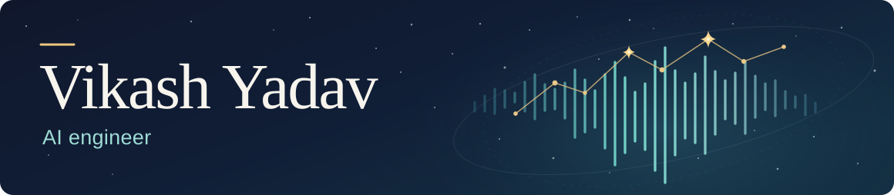

  

I build AI assistants you can talk to. My favorite part is getting the interaction right, whether it’s letting you interrupt a spoken question or asking before an assistant taps something on your phone.

## Two projects you can try

### [Jarvis · an on-device Android assistant](https://github.com/Vikashy05/jarvis-phone-assistant)

I built Jarvis for my Xiaomi Mi 11X. Give it a goal like **“Mute the media, then open YouTube.”** A small Qwen model runs on the phone and chooses one step at a time. You can review a proposed tap or text edit before it happens.

[Build and install Jarvis](https://github.com/Vikashy05/jarvis-phone-assistant#build-and-install-from-windows) · [Read the Kotlin planner](https://github.com/Vikashy05/jarvis-phone-assistant/blob/main/app/src/main/java/dev/local/jarvis/LocalPlanner.kt)

### [Jerry · a voice interviewer you can interrupt](https://github.com/Vikashy05/-voice-interview-agent)

Jerry asks seven machine learning questions and listens while it speaks. Try interrupting a question, then try a quick **“mm-hmm.”** Its interruption logic treats those differently. After the session, you can review the transcript and timing.

[Run a practice interview](https://github.com/Vikashy05/-voice-interview-agent#running-the-app) · [Explore the interruption logic](https://github.com/Vikashy05/-voice-interview-agent/blob/main/interview_agent/interrupt.py)

## What I work with

| Area | Tools I use |
| --- | --- |
| Voice and language | Python, LangGraph, LangChain, Groq Whisper, Edge TTS |
| On-device and enterprise assistants | Kotlin, MediaPipe, Microsoft Copilot Studio, Azure AI Search |
| Machine learning and APIs | PyTorch, scikit-learn, FastAPI, PostgreSQL, Docker |

I also work on résumé matching and anomaly detection in sensor data. If you’re building a voice assistant or running small models on Android, I’d love to compare notes.

If you try one of the projects and find it useful, a ★ on its repository helps other people discover it.
